<p align="center"></p>

<h1 align="center">The Epstein Files - Lion Studios</h1>
<p align="center"><b>An investigator's desk over the public Epstein records</b><br>
349,000 documents and 585,000 pages from the DOJ, House Oversight and court releases, read as one case file: every person, place, date,
e-mail, flight and dollar amount, every link between them backed by a quoted page, and a case notebook. One static Rust binary over SQLite, any browser.</p>

<p align="center"><em>Created by <a href="https://github.com/sunnychase">Sunny Chase</a> in collaboration with Claude (Anthropic).</em></p>

<p align="center">
  <a href="https://github.com/sunnychase/lion-epstein-files-studio/actions/workflows/ci.yml"></a>
  <a href="LICENSE"></a>
  <a href="#requirements"></a>
  <a href="#requirements"></a>
  <a href="#how-it-works"></a>
  <a href="https://cesium.com/platform/cesiumjs/"></a>
  <a href="#sources"></a>
  <a href="https://github.com/sunnychase/lion-epstein-files-studio/commits/main"></a>
  <a href="https://github.com/sunnychase/lion-epstein-files-studio"></a>
  <a href="https://donate.stripe.com/fZuaER2Cbecw7cQ6PlfEk00"></a>
</p>

<p align="center">
  <a href="https://x.com/LionFMN"></a>
</p>

<p align="center">
  <a href="#quick-start">Quick start</a> ·
  <a href="#how-it-works">How it works</a> ·
  <a href="#features">Features</a> ·
  <a href="#sources">Sources</a> ·
  <a href="#requirements">Requirements</a> ·
  <a href="#configuration">Configuration</a> ·
  <a href="#limits-and-caveats">Limits</a> ·
  <a href="#faq">FAQ</a> ·
  <a href="#contributing">Contributing</a>
</p>

<p align="center"><a href="samples/video/the-epstein-files-reel-59s.mp4">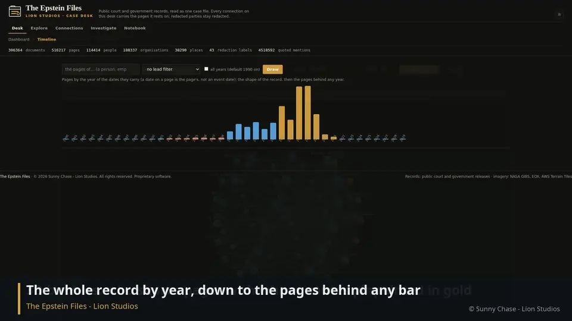</a><br>
<sub>▶ <a href="samples/video/the-epstein-files-reel-59s.mp4"><b>Watch the 59-second showcase reel</b></a> (MP4, 1080p, with an original score): dashboard, timeline, 3D bubbles, a real Earth, follow the money, the graph and the leads. Recorded from the live studio; public records only.</sub></p>

The Epstein Files puts eleven public releases on one desk. An ingest pipeline reads every page (the PDF's own text or the
production's text files), finds the people, organisations, places, dates, e-mail addresses, phone numbers, aircraft and dollar
amounts on it, and writes each mention with its 280-character quote into one SQLite file. The studio then answers the
investigator's questions: who shares pages with whom, what chain of pages joins two names, where the places are, who paid whom,
what the e-mail headers say, and which patterns in the mentions are worth a closer look. Nothing exists without a mention; no
link without the pages behind it; the files' redactions stay redacted.

## Quick start

```bash
git clone https://github.com/sunnychase/lion-epstein-files-studio.git && cd lion-epstein-files-studio
sudo apt install python3 python3-venv poppler-utils unzip curl        # pdftotext / pdftoppm for the pages
python3 -m venv .venv && . .venv/bin/activate && pip install spacy && python3 -m spacy download en_core_web_lg

# the court files: 944 pages, 20 minutes (every other source is in docs/GETTING-STARTED.md)
mkdir -p data/ia-giuffre-maxwell-1320 && I=jeffrey-epstein-files-full
echo "item $I (archive.org), fetched $(date -Is)" > data/ia-giuffre-maxwell-1320/SOURCE.txt
curl -sL "https://archive.org/download/$I/${I}_files.xml" | grep -o 'name="[^"]*\.pdf"' | cut -d'"' -f2 | while read -r f; do
  curl -sL --retry 3 -o "data/ia-giuffre-maxwell-1320/$f" "https://archive.org/download/$I/$f"; done
python3 ingest.py --db efiles.db --mode pdf --source data/ia-giuffre-maxwell-1320 --item ia-giuffre-maxwell-1320 \
  --title "Giuffre v. Maxwell: documents unsealed January 2024" --url "https://archive.org/details/$I"
python3 merge.py --db efiles.db && python3 extras.py --db efiles.db && python3 geo.py --db efiles.db && python3 money.py --db efiles.db

cd rust && cargo build --release && cd ..                            # or: python3 server.py (same API, same page)
EFILES_ROOT=. ./rust/target/release/efiles-server                     # then open http://127.0.0.1:8670
```

**[docs/GETTING-STARTED.md](docs/GETTING-STARTED.md)** walks through every source on archive.org (the DOJ data sets, the House
productions, the FOIA release), the ingest modes, timings, the compressed image packs and running it as a service.

## How it works

```
  browser (desktop or phone)
  the desk: search, people & things, graph (d3), 3D bubbles (3d-force-graph), globe (CesiumJS), money, timeline, notebook
        │
        │  http://127.0.0.1:8670   the page, and /api/* for every question
        ▼
  efiles-server (rust/): one static binary, axum over SQLite with FTS5; the page is embedded at build time
  server.py: the same API in plain Python (standard library), kept as the reference and the fallback
        │
        ▼
  efiles.db: documents · pages · entities · mentions (entity, page, offset, quote) · links (with the pages as evidence)
             emails · geo · payments · profiles · notebook                      5.6 GB for the full corpus
        ▲
        │  ingest.py (pdftotext + spaCy en_core_web_lg + regexes) · merge.py · extras.py · geo.py · money.py · enrich.py
        │
  data/<item>/  one folder per public release, each with SOURCE.txt naming the archive.org item
```

The docket header, the Bates stamp and "Page i of j" are masked on every page before extraction, so a stamp never becomes
evidence. Redaction labels (Doe 3, [REDACTED], a black block) are objects of their own and are never resolved to a person.
`aliases.json` and `merge.py` fold OCR and spelling variants of one person, with the rule recorded for every merge.

## Features

<p align="center"></p>

| | |
|---|---|
| 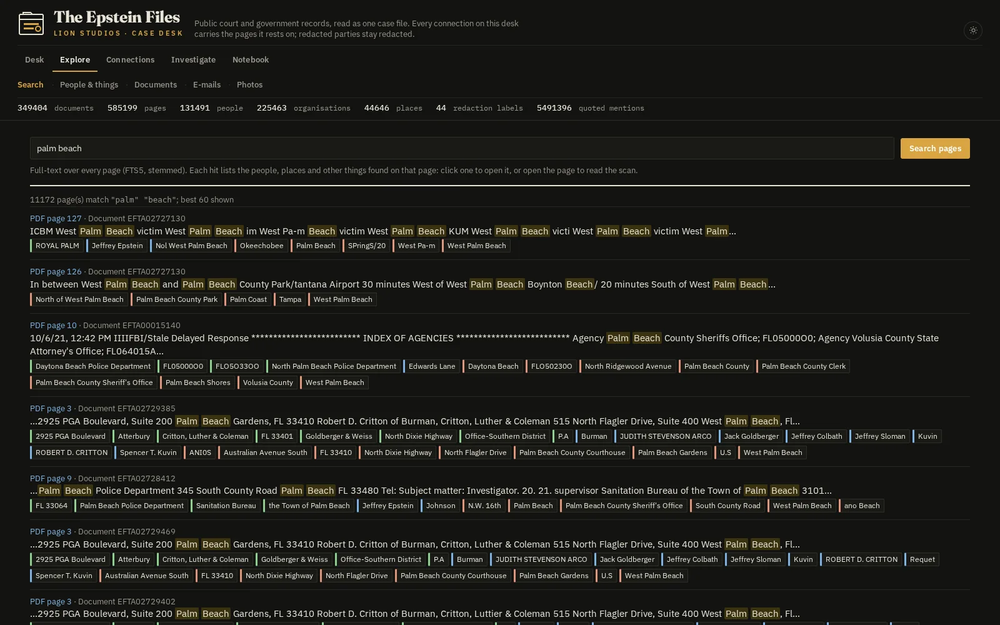 | **Search every page.** FTS5 full text with phrases, AND / OR / NOT and NEAR; every hit lists the people, places and things found on that page, opens the page, and shows the scan beside the text with every recognised name highlighted. |
| 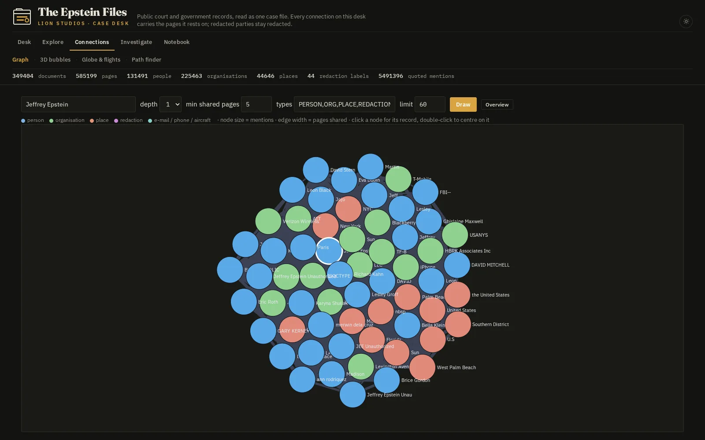 | **People & things, and the graph.** Each person, organisation, place, date, e-mail, phone, aircraft and case number has its documents, every mention quoted with its page, and who shares pages with it. The graph draws the connections around anyone: node size by mentions, edge width by pages shared; double-click to re-centre. |
| 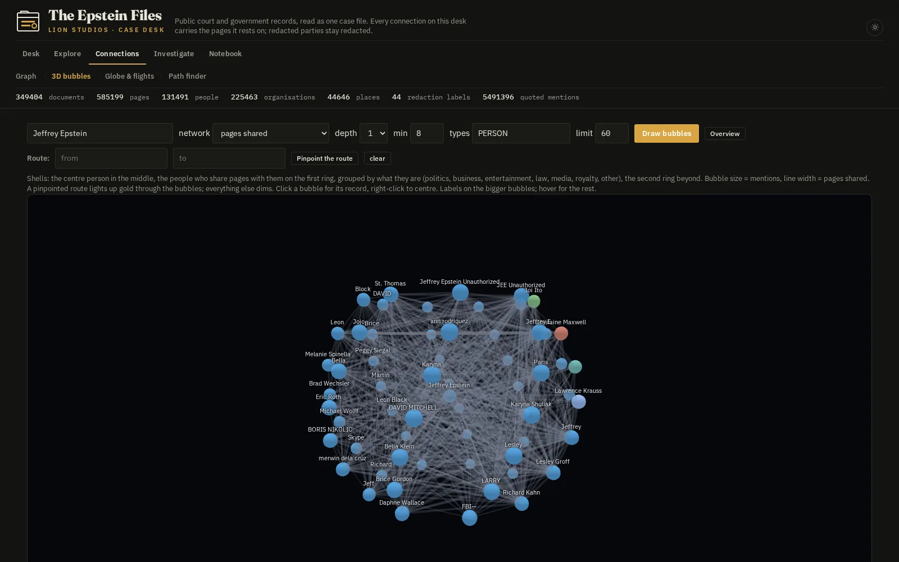 | **3D bubbles.** The people around a focus person in shells by hop, grouped by what they are (politics, business, law, media, royalty …), bubble size by mentions. Pinpoint a route between two names and it lights up in gold through the bubbles. |
| 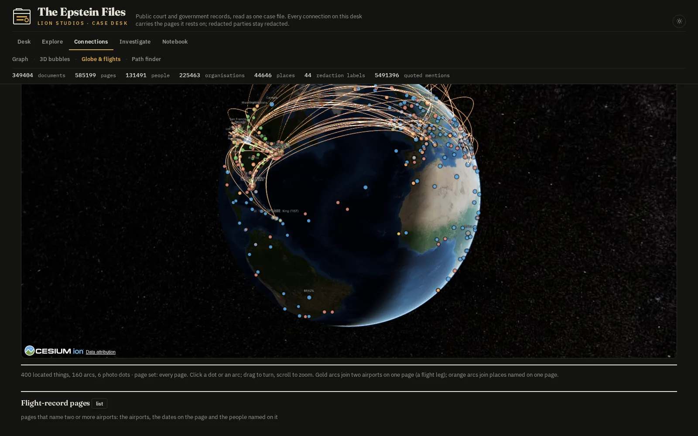 | **Globe & flights.** A real Earth (NASA Blue Marble, Sentinel-2 cloudless imagery close up, terrain, sunlight) with every located place, airport and country in the page set, sized by the pages that mention it. Arcs join two located things that share a page; gold arcs between airports are flight legs read from the flight-record pages. White dots are picture pages. |
| 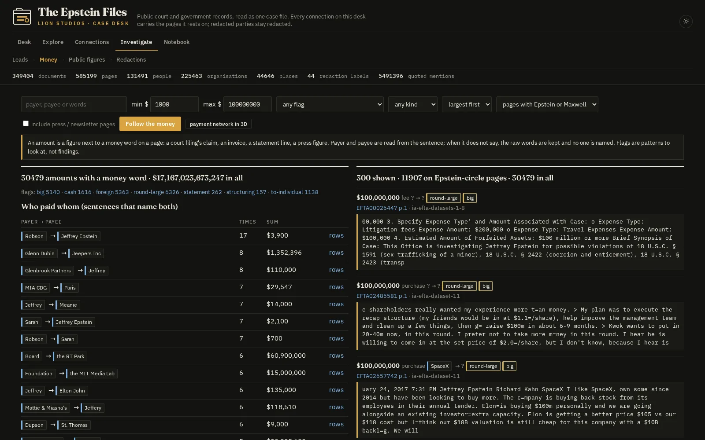 | **Follow the money.** Every dollar amount on every page, read with the sentence around it: the verb near it (paid, wired, loan, settlement, donation …), payer and payee when the sentence names both, flags for cash, round large sums, structuring and foreign jurisdictions, and a press filter that keeps newsletter pages apart from the Epstein-circle pages. |
| 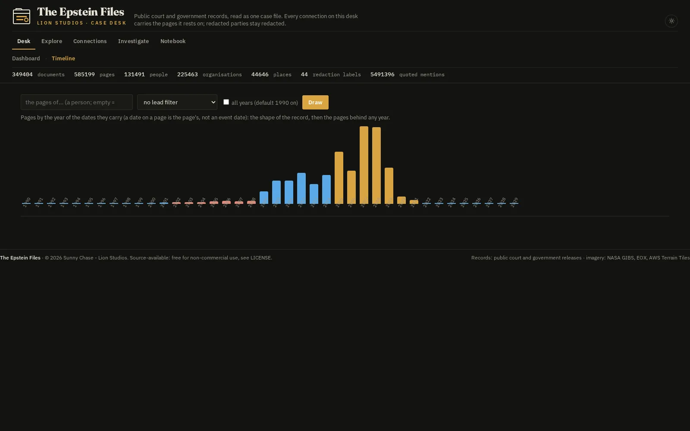 | **Timeline and path finder.** The pages of anyone by the year of the dates they carry, with the pages behind every bar. The path finder gives the chain of shared pages between any two things, with the quotes that make each hop; a hop means both appear on the same page, nothing more. |
| 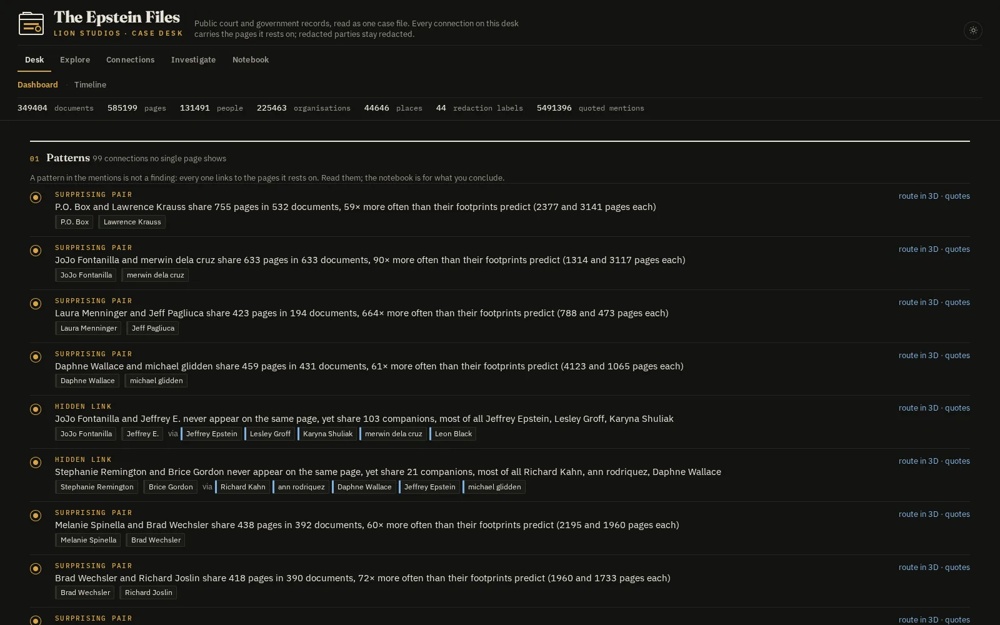 | **Patterns.** Surprising pairs (co-mention far above what their footprints predict), hidden links (never on the same page, yet many shared companions), bridges (a phone, an e-mail or an aircraft shared by three or more people), across sources, and public figures on lead pages. Each is a route into the bubbles and the quotes. A pattern in the mentions is not a finding; the notebook is for what you conclude. |
| 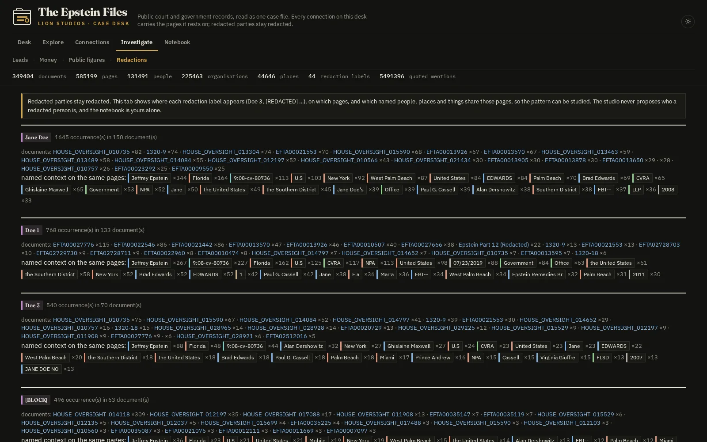 | **Redactions, e-mails, photos, public figures, leads.** Every redaction label with its documents and the names around it; 357,000 printed e-mail headers as a table with typed sender-to-recipient links; 46,000 picture pages; Wikipedia one-liners for the public figures (exact title match only; context, never evidence); saved lead queries by theme. |
| 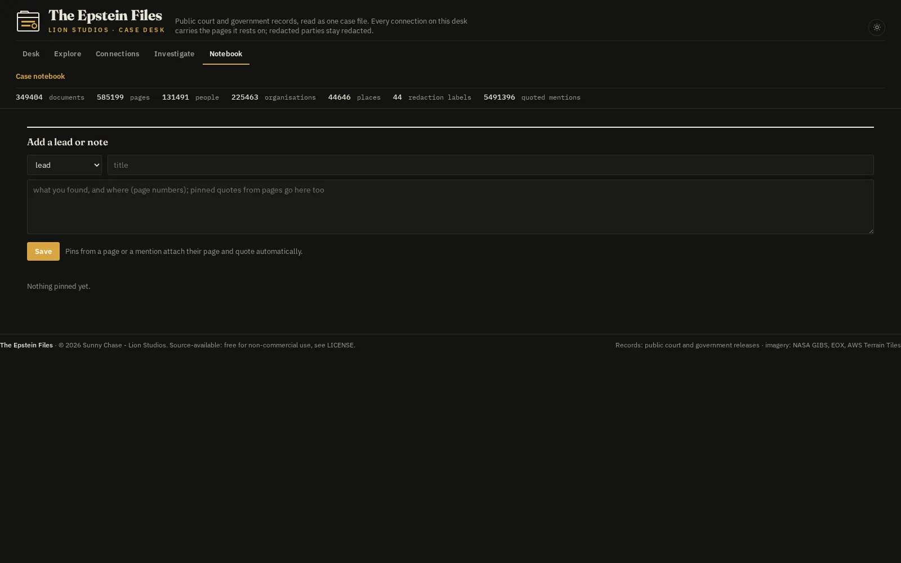 | **Case notebook.** Pin pages and quotes, keep leads, notes and open questions. The export is the SQLite table. A day theme (paper) and a night theme (lamp-dark), switched from the masthead or with `?theme=light`. |

**By day, and on a phone:**

<p>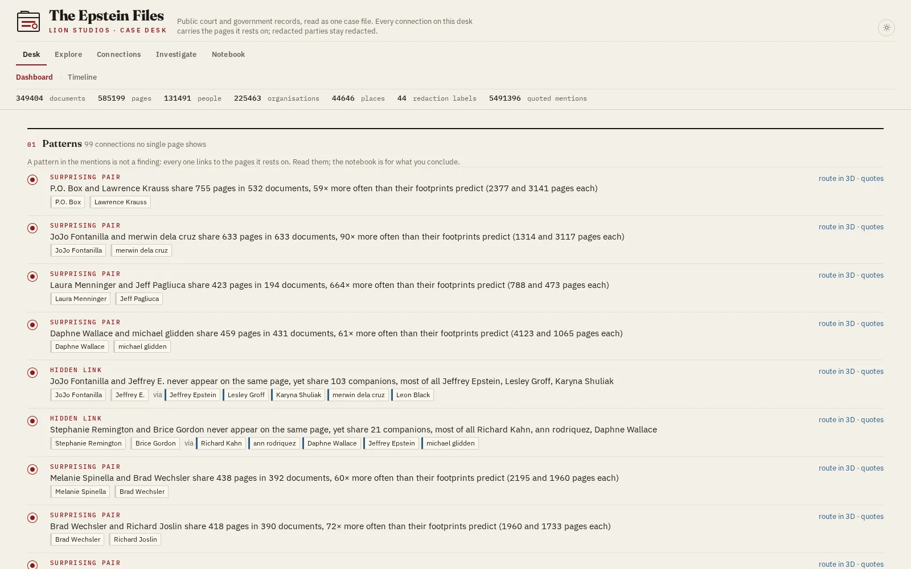 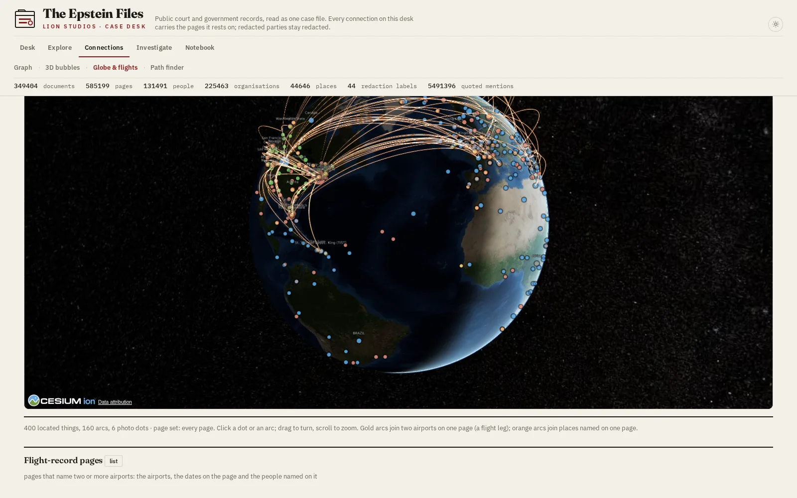</p>
<p>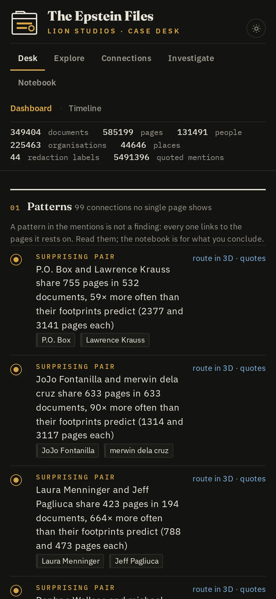</p>

## Sources

Eleven public items from the Internet Archive, 349,000 documents and 585,000 pages. Each keeps its provenance (item, file, PDF
page) and the studio shows it on every page.

| item | what | pages |
|---|---|---|
| [jeffrey-epstein-files-full](https://archive.org/details/jeffrey-epstein-files-full) | Giuffre v. Maxwell, S.D.N.Y. 15-cv-7433: the documents unsealed in January 2024 | 944 |
| [EFTA_12-23-25](https://archive.org/details/EFTA_12-23-25) | DOJ Epstein Files Transparency Act data sets 1-8 | 39,002 |
| [epstein-files-data-set-11](https://archive.org/details/epstein-files-data-set-11) | DOJ data set 11 | 517,382 |
| [doj_epstein_library_foia_florida_202602](https://archive.org/details/doj_epstein_library_foia_florida_202602) | DOJ FOIA release, Florida, 27 redacted parts | 2,931 |
| [oversight-committee-additional-epstein-files](https://archive.org/details/oversight-committee-additional-epstein-files) | House Oversight additional estate documents, 2025-11-12 | 23,109 |
| [epstein-doj-datasets-9-11-jan2026](https://archive.org/details/epstein-doj-datasets-9-11-jan2026) | the 250-document subset of data sets 9-11 | 1,125 |
| [jeffrey-epstein-part-22-of-22_20250227_2148](https://archive.org/details/jeffrey-epstein-part-22-of-22_20250227_2148) | FBI Vault records, Phase I, parts 1-8 | 289 |
| [jeffrey-epstein-flight-logs_202009](https://archive.org/details/jeffrey-epstein-flight-logs_202009) | the flight-log exhibits and the 1997-2006 manifest records | 119 |
| [epstein-birthday-book](https://archive.org/details/epstein-birthday-book) | the 50th-birthday book (House Oversight, Request No. 1) | 238 |
| [gx-606](https://archive.org/details/gx-606) | GX 606, U.S. v. Maxwell: the Palm Beach household manual | 59 |
| watchlist | the builder's compiled watchlist of deaths and open investigations after the releases (press and official statements; not a record) | 1 |

The image-only releases (DOJ data sets 9 and 10, the House first production of 33,295 pages) are fetched by
`nas_fetch_images.sh` and await OCR. The "black book" items on archive.org are deliberately not ingested.

**Page images.** The viewer shows the scan beside the text: a production's own image when the page has one, otherwise a render of
the PDF page cached on first view. The House 2025-11-12 production's 23,124 page images ship compressed (1300 px tall, greyscale,
a tenth of the release scans, every line legible) as a GitHub release; `./fetch_images.sh house-additional-2025-11-12
data/ia-house-oversight-additional-20251112` downloads, verifies and unpacks them, and `tools/backfill_images.py` points each page at
its image by Bates number. `tools/compress_images.py` makes such a pack from any image set, streaming straight from archive.org.

## Requirements

| | |
|---|---|
| **Server** | Linux or macOS. The Rust binary needs Rust **1.80+** and a C compiler (for the bundled SQLite); or run `server.py` on Python **3.10+** with nothing installed. Developed on an NVIDIA DGX Spark (aarch64, Ubuntu 24.04). |
| **Ingest** | Python 3.10+ with spaCy and `en_core_web_lg`; poppler-utils (`pdftotext`, `pdftoppm`). ImageMagick only to make image packs. 16+ cores and 32 GB make the full corpus a day's unattended job; 4 cores and 8 GB handle the court files in 20 minutes. |
| **Browser** | A current Chrome, Edge, Firefox or Safari. The globe needs **WebGL 2** (hardware acceleration on); everything else works without it. Phones work. |
| **Disk** | ~5 GB for the court files; ~150 GB of sources plus a 5.6 GB database for the full corpus; 2.4 GB for the compressed House image pack. |
| **Network** | archive.org for the sources, GitHub for the image packs; at run time NASA GIBS, EOX and AWS terrain tiles for the globe, Wikipedia for the public-figure one-liners (optional). No account anywhere. |

## Configuration

Settings are environment variables; `systemd/efiles-web.service` shows a user unit with all of them.

| Setting | Default | What it does |
|---|---|---|
| `EFILES_HOST` | `127.0.0.1` | Bind address. `0.0.0.0` makes it reachable from your LAN (see the note below). |
| `EFILES_PORT` | `8670` | Port. |
| `EFILES_ROOT` | the working directory | The folder that holds `efiles.db`, `data/` and `suppressed.json`. |
| `EFILES_DB` | `<root>/efiles.db` | The database. |
| `EFILES_DATA` | `<root>/data` | The sources (Python server). |
| `EFILES_CACHE` | `<root>/cache` | Rendered page images and thumbnails. |

**Using it from your phone or another computer.** There is no login. On a network you trust, set `EFILES_HOST=0.0.0.0` and open
`http://<server-address>:8670`. Anywhere else, keep the default and put it behind an authenticating reverse proxy or tunnel
(Tailscale, Cloudflare Access, nginx with auth). Never expose it bare to the internet: the notebook is writable by anyone who can
reach the port.

## Limits and caveats

Honest notes from building it:

- **A name on a page is a mention, nothing more.** The wording everywhere is "shares pages with", not "linked to". A high
  co-mention lift says two names keep appearing together in these files; it says nothing about why.
- **The text is what the releases carry.** OCR errors in the government productions become entities (`merge.py` folds the obvious
  ones, conservatively); a mis-read name stays mis-read. Pages are the unit of evidence, so a quote is always from one page.
- **Entity recognition is statistical.** spaCy misses some names and invents a few (a street, a ship, a court form field).
  `suppressed.json` lists what was removed by hand; the counts in the masthead are after those removals.
- **Money is read from sentences.** Payer and payee come from the sentence that names both and a money verb; the raw amounts are
  kept, the flags are patterns to look at, not findings. Press and newsletter pages are marked and filtered by default.
- **Places are where the words point.** The gazetteer is offline and conservative; an airport is read from ICAO / IATA codes on
  pages that look like flight records. A dot on the globe means the page names the place.
- **Public-figure cards are Wikipedia one-liners**, matched on the exact title only. They are context for the reader, never evidence,
  and a same-name person can still slip through.
- **Image-only releases have no text yet** (DOJ data sets 9 and 10, the House first production); their pages are not searchable
  until an OCR pass is added.
- **The redactions stay redacted.** The studio shows where a redaction is and what surrounds it, and never proposes who a
  redacted person is. That is a condition of the [licence](LICENSE) too.
- **No login.** See [Configuration](#configuration) before opening it to a network.

## FAQ

<details>
<summary><b>Do I need an account or an API key?</b></summary>

No. The sources are public items on archive.org, the image packs are public GitHub releases, and the globe's imagery (NASA GIBS,
EOX, AWS terrain) and the Wikipedia lookups are keyless.
</details>

<details>
<summary><b>Why Rust, and do I have to build it?</b></summary>

The Rust server is one 33 MB static binary with the page embedded: no interpreter, no files to deploy, fast on the 5.6 GB corpus.
You do not have to build it: `python3 server.py` is the same API and the same page on the standard library alone, and it is the
reference the Rust port is checked against.
</details>

<details>
<summary><b>The globe shows an error, or stays black</b></summary>

CesiumJS needs WebGL 2. The globe tab tests for it and tells you what to do (turn on hardware acceleration, override the software
rendering list, or set `webgl.force-enabled` in Firefox). A browser in a snap or a VM often has no GPU access; the rest of the desk
works without the globe.
</details>

<details>
<summary><b>Can I use it commercially?</b></summary>

Not without written permission: the code is source-available, free for personal, educational, journalistic, research and other
non-commercial use. See [LICENSE](LICENSE). The records are public documents and are not licensed by this repository; the EOX
imagery on the globe is CC BY-NC-SA 4.0.
</details>

<details>
<summary><b>How long does the full corpus take?</b></summary>

On a 20-core ARM box: the court files 3 minutes; data sets 1-8 40 minutes; data set 11 (517,000 pages) 2.5 hours; the
second-pass tools 10 minutes together. The dashboard builds in 7 seconds and the patterns in 21 seconds on the first view, then
come from a cache.
</details>

<details>
<summary><b>Can I add a source of my own?</b></summary>

Yes: a folder under `data/` with a `SOURCE.txt`, one `ingest.py` run with the mode that matches its shape (`pdf`, `pdfdocs` or
`production`), then the second-pass tools. A plain text file becomes a PDF with `txt2pdf.py` so it goes through the same pipeline.
Step by step in [docs/GETTING-STARTED.md](docs/GETTING-STARTED.md).
</details>

<details>
<summary><b>Does it identify the redacted people?</b></summary>

No, by design and by licence. Redaction labels are objects with their documents and the names around them, so the pattern can be
studied; the studio never proposes who a redacted person is, and the licence forbids using it for that.
</details>

## Roadmap

- **OCR** for the image-only releases (DOJ data sets 9 and 10, the House first production), then their compressed image packs.
- **Court dockets** from CourtListener (needs a free token) beside the archive.org items.
- **Typed relations** read from the sentence (represented, employed, flew with, paid) beside the co-mention links.
- **One-click image packs** from the desk, with progress, instead of the two shell commands.
- A **"what changed"** view when a new data set is released.

Ideas and pull requests are welcome: see [Contributing](#contributing).

## Repository

```
rust/                     the server as one static binary: main.rs (router, static files), api.rs (every endpoint), db.rs (pool, helpers)
server.py                 the same API in plain Python (standard library + SQLite), the reference and the fallback
ingest.py                 PDFs / per-document PDFs / load-file productions -> documents, pages, entities, mentions, links
merge.py extras.py geo.py money.py enrich.py   the second pass: name variants, e-mails and photos, the globe, the money, public figures
aliases.json email_owners.json suppressed.json  the hand-kept lists (name aliases, documented e-mail owners, removed entities)
static/                   the page: index.html, app.css, globe.js, fonts/ (OFL), vendor/ (d3, 3d-force-graph, CesiumJS)
tools/                    compress_images.py, backfill_images.py, the reel recorder and score
fetch_images.sh fetch_small_sources.sh nas_fetch_images.sh txt2pdf.py   fetching sources and packs
systemd/                  a user unit for the binary
docs/                     GETTING-STARTED.md, images/ (screenshots), media/ (the README preview)
samples/                  the 59 s reel and the watchlist text
scripts/check.sh          the CI checks
```

## Contributing

Bug reports and focused pull requests are welcome: [open an issue](https://github.com/sunnychase/lion-epstein-files-studio/issues)
or [send a pull request](https://github.com/sunnychase/lion-epstein-files-studio/pulls). Keep machine-specific settings in the
environment, never in the code; keep the redactions redacted; keep every link backed by its pages. [CONTRIBUTING.md](CONTRIBUTING.md)
covers running a development copy and the checks (`bash scripts/check.sh`); [AGENTS.md](AGENTS.md) is a short guide for coding agents.
Report security problems privately, as described in [SECURITY.md](SECURITY.md). Changes are listed in [CHANGELOG.md](CHANGELOG.md).

If the project is useful to you, you can support it with a [donation](https://donate.stripe.com/fZuaER2Cbecw7cQ6PlfEk00).

## Star history

<a href="https://www.star-history.com/#sunnychase/lion-epstein-files-studio&Date">
  <picture>
    <source media="(prefers-color-scheme: dark)" srcset="https://api.star-history.com/svg?repos=sunnychase/lion-epstein-files-studio&type=Date&theme=dark">
    <source media="(prefers-color-scheme: light)" srcset="https://api.star-history.com/svg?repos=sunnychase/lion-epstein-files-studio&type=Date">
    
  </picture>
</a>

## Credits

Created by **[Sunny Chase](https://github.com/sunnychase)** in collaboration with **Claude** (Anthropic). The records are public
court and government releases mirrored on the Internet Archive; the globe's imagery comes from NASA GIBS, EOX and AWS Terrain
Tiles; software and fonts as listed in [NOTICE.md](NOTICE.md).

## License

(c) 2026 Sunny Chase - Lion Studios. The code is under the [Lion Studios Source-Available Licence](LICENSE): free to study, run and
modify for non-commercial use with attribution; commercial use and published forks need written permission. d3 (ISC),
3d-force-graph (MIT), CesiumJS (Apache-2.0), the fonts (SIL OFL 1.1) and the Rust crates are included under their own terms; see
[NOTICE.md](NOTICE.md). The documents belong to the public record.
